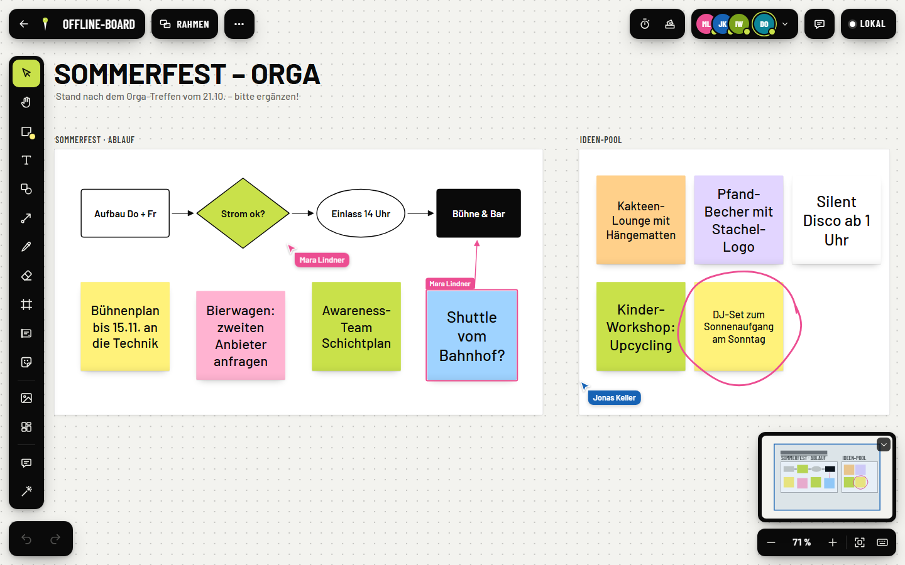

# Stachel

[](https://github.com/goeranhegenberg/stachel/actions/workflows/ci.yml)
[](https://github.com/goeranhegenberg/stachel/pkgs/container/stachel)
[](LICENSE)

**Stachel** is a self-hostable online whiteboard for teams: an endless canvas with sticky notes, shapes, connectors,
mind maps, tables, timelines, PDFs and comments – everybody sees every change live. One Docker container, one SQLite
file, no trackers, no external calls.

*Deutsch: [weiter unten](#deutsch) · Funktionsliste auf Deutsch: [`docs/funktionen.md`](docs/funktionen.md)*



<!-- More screenshots (mobile, mind map, sharing) will follow on the project page. -->

## Features

- **Endless canvas** with smooth zoom, minimap, grid, snapping and alignment guides, frames (16:9, A4, phone …) and
  presentation mode.
- **Content:** sticky notes, rich text (formatting per word, lists, checklists, headings), 40+ shapes incl. a complete
  flow-chart set, connectors (straight, elbow, curved; labels, 9 arrow heads), pen, highlighter, images, stickers, icons,
  PDFs (pages on the board), cards, tables, mind maps, Kanban and timelines, 11 templates.
- **Realtime collaboration:** live cursors, presence, follow mode, laser pointer, cursor chat, comments with @mentions,
  reactions, voting, shared timer. Built on [Yjs](https://yjs.dev) CRDTs – short offline periods merge without conflicts.
- **Accounts and sharing:** registration with a privacy-friendly proof-of-work captcha, optional e-mail confirmation,
  boards owned by a person and shared per e-mail or link with the roles *edit / comment / view*.
- **Safety nets:** undo across everything, trash (30 days), version history with automatic snapshots and restore.
- **Export** as PNG or PDF (board, selection, frames), board duplication, own templates.
- **Mobile:** works on phones and tablets (touch toolbar, pinch zoom, palm rejection); native Android app in
  [`flutter/`](flutter/).
- **AI access (MCP):** an optional [Model Context Protocol](https://modelcontextprotocol.io) server lets assistants such as
  Claude read and design boards live, with screenshots for self-checks ([`docs/features/mcp.md`](docs/features/mcp.md)).
- **Import from Miro** via the Miro REST API: copy your own boards into new Stachel boards with a personal access token or
  by connecting through your own Miro app ([`docs/selfhosting.md`](docs/selfhosting.md#import-from-miro)). Miro is a
  trademark of RealtimeBoard, Inc.; Stachel is not affiliated with Miro.
- **Privacy by design:** self-hosted fonts, no CDN, no analytics; Content-Security-Policy `default-src 'self'`.

The user interface is currently **German**.

## Quick start (Docker)

```bash
docker run -d --name stachel -p 8080:8080 -v stachel-data:/data ghcr.io/goeranhegenberg/stachel
```

Open <http://localhost:8080>, register – without a mail server the account is active right away – and create a board.
Data (SQLite database, images, PDFs) lives in the volume `stachel-data` and survives restarts and updates.

With Docker Compose (optional MCP server and Caddy for automatic HTTPS):

```bash
git clone https://github.com/goeranhegenberg/stachel.git && cd stachel
cp .env.example .env            # optional: PUBLIC_URL, SMTP, registration …
docker compose up -d                      # Stachel on :8080
docker compose --profile https up -d      # + Caddy with Let's Encrypt (set STACHEL_DOMAIN and PUBLIC_URL)
docker compose --profile mcp up -d        # + MCP server for AI assistants
```

Manage accounts from the command line:

```bash
docker exec stachel stachel-admin users                  # list accounts
docker exec stachel stachel-admin verify ada@example.org # confirm an account manually
docker exec stachel stachel-admin reset-link ada@example.org
```

Reverse proxy, backups, updates and mail setup: **[`docs/selfhosting.md`](docs/selfhosting.md)**.
Security notes for public instances: [`SECURITY.md`](SECURITY.md#running-your-own-instance).

Images: `ghcr.io/goeranhegenberg/stachel` and `ghcr.io/goeranhegenberg/stachel-mcp` for `linux/amd64` and
`linux/arm64` (tags `latest`, `1`, `1.0`, `1.0.0`).

## Configuration

Everything is configured with environment variables (Docker `-e`, `.env` next to `docker-compose.yml`, or `server/.env`
for development). All of them are optional. Template: [`.env.example`](.env.example).

### Basics

| Variable | Default | Description |
|---|---|---|
| `PUBLIC_URL` | `http://localhost:<PORT>` | Public address (origin) of the instance: links in e-mails and QR codes, WebSocket origin check, Secure cookies. **Set it** for anything but a local test. |
| `PORT` | `8080` (image), `8095` (dev) | HTTP port inside the container / process. |
| `HOST` | `0.0.0.0` | Listen address. |
| `DATA_DIR` | `/data` (image), `./data` (dev) | SQLite database `stachel.sqlite`, `images/`, `image-variants/`, `mail.log`. |
| `WEB_DIST` | `/app/web/dist` (image) | Built web app served by the server. |
| `COOKIE_SECURE` | `true` if `PUBLIC_URL` is https | Secure session cookies (and HSTS). |
| `TRUST_PROXY` | `loopback` | Proxies whose `X-Forwarded-For` is trusted (client IP for rate limits). Name only your own proxy, e.g. `172.17.0.1`; `uniquelocal` for the Caddy profile. Also `true`/`false`. |
| `ALLOWED_ORIGINS` | – | Additional allowed WebSocket origins, comma separated. |
| `LOG_LEVEL` | `info` | `trace`, `debug`, `info`, `warn`, `error`, `silent`. |
| `STACHEL_TOKEN_KEY` | – | 32-byte key (`openssl rand -base64 32`, or 64 hex chars) to encrypt stored login tokens (AES-256-GCM). Recommended. |

### Instance and accounts

| Variable | Default | Description |
|---|---|---|
| `STACHEL_AUTH` | `local` | `local`: own accounts. `org`: login through the identity service of an organisation and its app (QR code, app link, optional password); needs `STACHEL_ORG_IDENTITY_URL`, see below. Unknown values stop the server. |
| `STACHEL_BRAND` | `Stachel` | Name of the instance in the UI and e-mails (forks: please use your own name, see [TRADEMARKS.md](TRADEMARKS.md)). |
| `STACHEL_REGISTRATION` | `open` | `open`: anyone may register. `invite`: only addresses with a pending board invitation – the very first account may always register. |
| `STACHEL_REQUIRE_VERIFICATION` | on with SMTP, off without | Confirm the e-mail address before the first login (`1`/`0`). Without it, new accounts are active immediately. |
| `STACHEL_IMPRINT_URL` | – | Link to your imprint (footer, registration, e-mails). |
| `STACHEL_PRIVACY_URL` | – | Link to your privacy policy. |
| `STACHEL_TERMS_URL` | – | Link to your terms of service (registration checkbox “I accept the terms … at least 18 years old”, footer, e-mails). Empty: checkbox without a link and a warning at startup. |
| `STACHEL_LEGAL_DIR` | `DATA_DIR/legal` | Your own legal texts served by Stachel (`impressum.html`, `datenschutz.html`, `nutzungsbedingungen.html` → `/impressum` …); used as the links above when those are empty. Templates: `deploy/legal-templates/`. None are shipped. |
| `STACHEL_TERMS_VERSION` | – | Version of your terms (e.g. `2026-11-04`), stored with each consent; after a change logged-in people must accept again. |
| `STACHEL_CAPTCHA_MAX` | `250000` | Difficulty of the proof-of-work captcha (1 000 – 5 000 000). |
| `STACHEL_TEMPLATES_DIR` | `DATA_DIR/templates` | Folder with instance templates (`*.json`, shown in the template gallery; see [docs/selfhosting.md](docs/selfhosting.md#instance-templates)). |
| `STACHEL_TEMPLATES_CATEGORY` | `STACHEL_BRAND` or `Weitere Vorlagen` | Gallery category of the instance templates. |

### Login through an organisation (`STACHEL_AUTH=org`)

Stachel asks the organisation's identity service for every login token (`GET` with `Authorization: Bearer <token>` →
`{id, name, admin, status}`); interface in [docs/contract.md](docs/contract.md) §1.

| Variable | Default | Description |
|---|---|---|
| `STACHEL_ORG_IDENTITY_URL` | – (required) | Full URL that checks an organisation token. Missing = the server does not start. |
| `STACHEL_ORG_LOGIN_URL` | – | Optional password login through the organisation (`POST {username, password}` → `{token}`). Empty = QR code and app only. |
| `STACHEL_ORG_NAME` | `Organisation` | Name of the organisation in the UI (“Mit … anmelden”), at most 60 characters. |
| `STACHEL_ORG_APP_NAME` | `{STACHEL_ORG_NAME}-App` | Name of its app (“In der … öffnen”). |
| `STACHEL_ORG_TIMEOUT_MS` | `8000` | Timeout per call of the identity service. |

### E-mail (SMTP, optional)

Without `STACHEL_SMTP_HOST` no mail leaves the server: messages including their links are written to the server log
(`docker logs stachel`) and to `DATA_DIR/mail.log`.

| Variable | Default | Description |
|---|---|---|
| `STACHEL_SMTP_HOST` | – | SMTP server. |
| `STACHEL_SMTP_PORT` | `465` | Port. |
| `STACHEL_SMTP_SECURE` | `ssl` for 465, `none` for 25, else `starttls` | Transport encryption. |
| `STACHEL_SMTP_USER` / `STACHEL_SMTP_PASS` | – | Login. |
| `STACHEL_SMTP_FROM` | `STACHEL_SMTP_USER` | Sender, e.g. `Stachel <noreply@example.org>`. |
| `STACHEL_MAIL_MODE` | `smtp` | `log`: never send, only write `DATA_DIR/mail.log` (tests, sandbox). |

### Web app path and product page

| Variable | Default | Description |
|---|---|---|
| `STACHEL_BASE_PATH` | – (root) | Serve the web app under a path, e.g. `/app`. API, sync, app links and `/mcp` stay at the root. Reserved first segments (`api`, `sync`, `native`, `b`, `verify`, `reset`, …) are rejected. |
| `STACHEL_LANDING` | off | `1`: product page at `/` (only together with `STACHEL_BASE_PATH`). |
| `STACHEL_REPO_URL` | – | Source-code link on the product page. |
| `STACHEL_PLAY_URL` | – | Google Play link on the product page. |

### Reports, moderation and limits

| Variable | Default | Description |
|---|---|---|
| `STACHEL_REPORT_EMAIL` | `STACHEL_SMTP_FROM` | Where reports of content, comments, boards and people are sent (needs SMTP). |
| `STACHEL_ADMIN_TOKEN` | – (off) | Admin API for `tools/admin.mts` (decide reports, lock boards and accounts); at least 32 characters. See `docs/ops/moderation.md`. |
| `STACHEL_UPLOAD_MAX_MB`, `STACHEL_USER_QUOTA_MB`, `STACHEL_UPLOADS_PER_HOUR`, `STACHEL_MAX_BOARDS_PER_USER`, `STACHEL_INVITES_PER_HOUR`, `STACHEL_INVITES_PER_DAY`, `STACHEL_INVITES_PER_DAY_IP` | see `docs/ops/limits.md` | Upload size, storage quota per account, upload rate, boards per person and invitation mails (`0` = unlimited where noted). |

### AI access (MCP)

| Variable | Default | Description |
|---|---|---|
| `MCP_PUBLIC_URL` | `{PUBLIC_URL}/mcp` | Address of the MCP server shown in the “AI access” dialog. |

The MCP container (`ghcr.io/goeranhegenberg/stachel-mcp`) reads `STACHEL_URL` (address of Stachel, e.g.
`http://stachel:8080`), `PORT` (`8096`), `HOST`, `MCP_PATH` (`/mcp`), `STACHEL_WEB_URL` (web app for screenshots, default
`STACHEL_URL`), `STACHEL_MCP_BROWSER`, `STACHEL_MCP_SHOT_TIMEOUT_MS` and `MCP_TARBALL`.

### Import from Miro

| Variable | Default | Description |
|---|---|---|
| `STACHEL_IMPORT` | `on` | `off` switches the import off completely. |
| `STACHEL_IMPORT_MIRO_TOKEN` | `on` | `off`: no pasting of personal Miro access tokens. |
| `MIRO_CLIENT_ID` / `MIRO_CLIENT_SECRET` | – | Your own Miro app for „Mit Miro verbinden“ (OAuth, scope `boards:read`, redirect URI `<PUBLIC_URL>/api/import/miro/callback`); setup and limits in [docs/selfhosting.md](docs/selfhosting.md#import-from-miro). |

### Native apps

| Variable | Default | Description |
|---|---|---|
| `STACHEL_ANDROID_PACKAGE` | – | Android package for App Links (`/.well-known/assetlinks.json`): the Stachel app (`local`) or the organisation's app (`org`; also enables the “open in the app” button on phones). No default in any mode. |
| `STACHEL_ANDROID_CERT_SHA256` | – | SHA-256 fingerprints of the signing certificate(s), comma separated. Empty = no App Links. |
| `STACHEL_IOS_APP_ID` | – | `TEAMID.bundle.id` for iOS Universal Links. No default in any mode. |
| `STACHEL_NATIVE_MIN_APP` / `STACHEL_NATIVE_MIN_STACHEL_APP` | – | Minimum app versions accepted by the native API (organisation's app / Stachel app). |
| `STACHEL_NATIVE_DEV_ACTIONS` | off | `1` enables sandbox actions of the native API – testing only. |

### Docker Compose only

`STACHEL_HTTP_PORT` (host port, default `8080`), `STACHEL_MCP_PORT` (`8096`), `STACHEL_VERSION` (image tag, `latest`),
`STACHEL_DOMAIN` (domain for the Caddy profile).

## Native apps

[`flutter/`](flutter/) contains the Flutter code shared by the native apps:

- `flutter/packages/stachel_board` – board model, renderer and editor (talks to the server's native API,
  [`docs/contract.md`](docs/contract.md) §8),
- `flutter/packages/stachel_client` – app layer (board list, sharing, offline cache, documents, comments),
- `flutter/app` – the **Stachel** Android app (`com.intsode.stachel`). It connects to `https://stachel.intsode.com` by
  default; build your own with `flutter build apk --dart-define=STACHEL_BASE=https://board.example.org`.

## Development

Node.js 22.13+. Every folder is its own npm package:

```bash
cd server && npm ci && printf 'STACHEL_AUTH=local\nSTACHEL_MAIL_MODE=log\n' > .env && npm run dev   # :8095
cd web && npm ci && npm run dev                                                                         # :5173
```

Tests: `npm test` in `server/` and `web/`, browser E2E with Playwright, Flutter tests in `flutter/` – details and rules in
[`CONTRIBUTING.md`](CONTRIBUTING.md).

## Architecture

```
 Browser (React + Yjs) ──HTTP /api──┐                         ┌── SQLite (boards, Yjs updates, accounts)
                      ──WS  /sync───┤  server/ (Node 22,       ├── data/images (images, PDFs)
 Android app (Flutter) ─WS /native──┤  Fastify + Hocuspocus)  │
 MCP server (AI) ───────HTTP + WS───┘  serves web/dist        └── SMTP (optional)
```

| Folder | Content |
|---|---|
| `shared/` | Types and constants shared by server and web (`protocol.ts`, `native.ts`) |
| `server/` | Node 22, Fastify, Hocuspocus (Yjs sync), SQLite (`node:sqlite`), sharp; serves the built web app |
| `web/` | Vite + React + TypeScript: editor core (`src/editor`) and feature modules (`src/features/<module>`) |
| `mcp/` | MCP server for AI assistants (stdio and Streamable HTTP, screenshots with headless Chromium) |
| `flutter/` | Flutter packages and the Android app |
| `e2e/` | End-to-end tests against the real server |
| `docs/` | Contract ([`contract.md`](docs/contract.md)), architecture ([`architecture.md`](docs/architecture.md)), module contracts ([`docs/features/`](docs/features/)), screenshots – mostly German |

The server is the single source of truth: browsers sync Yjs documents over WebSocket, the native apps speak a JSON
protocol and the server applies their operations with the same web code (no duplicated business logic).

## License

[Apache License 2.0](LICENSE) – see also [NOTICE](NOTICE) and [THIRD_PARTY_NOTICES](THIRD_PARTY_NOTICES). The name
“Stachel” and the logo are not covered by the license: [TRADEMARKS.md](TRADEMARKS.md).
Contributions: [CONTRIBUTING.md](CONTRIBUTING.md) (DCO sign-off, no CLA) · [Code of Conduct](CODE_OF_CONDUCT.md) ·
[Security](SECURITY.md).

---

## Deutsch

**Stachel** ist ein selbst gehostetes Online-Whiteboard für Teams: endlose Fläche mit Haftnotizen, Formen, Verbindern,
Mindmaps, Tabellen, Zeitleisten, PDFs und Kommentaren – alle sehen jede Änderung sofort. Ein Docker-Container, eine
SQLite-Datei, keine Tracker, keine externen Aufrufe. Die Oberfläche ist deutsch.

**Schnellstart:**

```bash
docker run -d --name stachel -p 8080:8080 -v stachel-data:/data ghcr.io/goeranhegenberg/stachel
```

Dann <http://localhost:8080> öffnen und registrieren – ohne Mailserver ist das Konto sofort aktiv. Für den Betrieb im
Netz `PUBLIC_URL` setzen, einen Reverse-Proxy mit HTTPS davor schalten (Compose-Profil `https` mit Caddy) und bei
öffentlicher Registrierung SMTP einrichten. Alle Einstellungen stehen oben unter [Configuration](#configuration), die
Vorlage in [`.env.example`](.env.example), Betrieb und Sicherung in [`docs/selfhosting.md`](docs/selfhosting.md).

Konten verwalten: `docker exec stachel stachel-admin users | verify <email> | reset-link <email>`.

Alle Funktionen auf Deutsch: [`docs/funktionen.md`](docs/funktionen.md). Beiträge sind auf Deutsch genauso willkommen
([`CONTRIBUTING.md`](CONTRIBUTING.md)); Sicherheitslücken bitte nicht öffentlich melden ([`SECURITY.md`](SECURITY.md)).
Lizenz: Apache 2.0; Name und Logo: [`TRADEMARKS.md`](TRADEMARKS.md).
