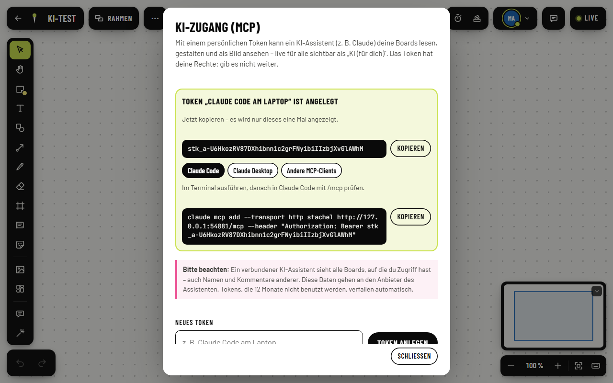
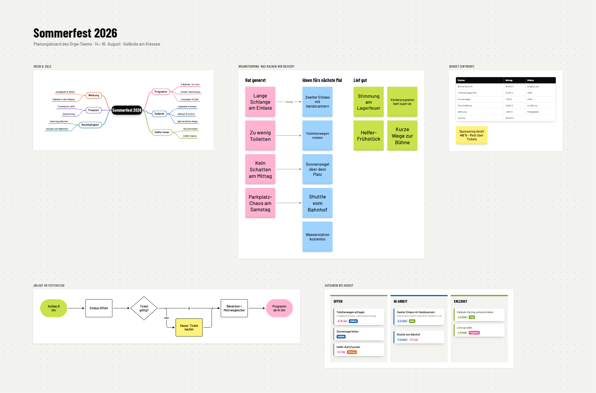
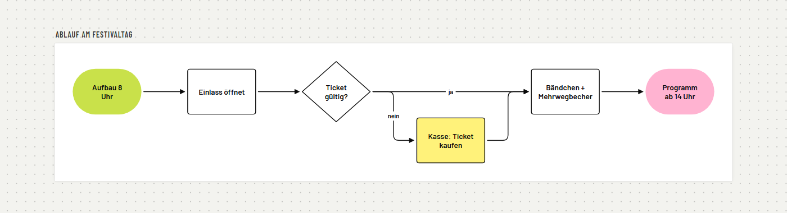

# KI-Zugang: MCP-Server für Stachel

Ein KI-Assistent (Claude Code, Claude Desktop oder ein anderer MCP-Client) kann Boards lesen, gestalten, umbauen und
als Bild ansehen – **live**: alle, die das Board offen haben, sehen jede Änderung sofort, und der Assistent erscheint
in der Anwesenheit als **„KI (für Mara)“** mit eigener Farbe und Cursor/Auswahl dort, wo er gerade arbeitet.



## Einrichten

1. Board öffnen → Menü **„···“** neben dem Titel → **„KI-Zugang (MCP) …“** → Namen eingeben (z. B. „Claude Code am
   Laptop“) → **Token anlegen**. Das Token (`stk_…`) erscheint nur dieses eine Mal; darunter die fertige Einrichtung zum
   Kopieren.
2. **Claude Code** (im Terminal):
   ```
   claude mcp add --transport http stachel https://board.example.org/mcp --header "Authorization: Bearer stk_…"
   ```
   Danach in Claude Code `/mcp` – „stachel“ ist verbunden.
3. **Claude Desktop** (`claude_desktop_config.json`, braucht Node.js; Bildschirmfotos nutzen Chrome oder Edge):
   ```json
   { "mcpServers": { "stachel": {
       "command": "npx",
       "args": ["-y", "https://board.example.org/mcp/stachel-mcp.tgz", "--url", "https://board.example.org"],
       "env": { "STACHEL_TOKEN": "stk_…" } } } }
   ```
   Das Paket liefert der Server selbst aus (kein npm-Konto nötig).
4. **Andere MCP-Clients:** Streamable HTTP `https://board.example.org/mcp` mit Header `Authorization: Bearer stk_…`.

Widerrufen: im selben Dialog „Widerrufen“ – das Token gilt sofort nicht mehr, ein verbundener Assistent fliegt raus.
Ablauf: Ein Token, das **12 Monate nicht benutzt** wurde, verfällt (401) und wird gelöscht; die Liste zeigt „verfällt am …“
(`expiresAt`, jede Nutzung schiebt es hinaus). Über dem Anlegen steht der Datenschutz-Hinweis (Web `MCP_PRIVACY_NOTE`, App
`stachelMcpPrivacyNote`): ein verbundener Assistent sieht alle Boards mit Zugriff – auch Namen und Kommentare anderer –, und
die Daten gehen an den Anbieter des Assistenten (docs/legal/datenschutz.md §8).

## Sicherheit

- Das Token hat die **Rechte der Person** (in `STACHEL_AUTH=local` genau die Board-Rollen, `docs/contract.md` §6;
  „ansehen“/„kommentieren“ lehnt der MCP-Server für schreibende Tools mit Hinweis ab). Es kann keine weiteren Tokens
  anlegen.
- Gespeichert wird nur der SHA-256-Hash; angezeigt wird nur der Name und die letzten 4 Zeichen. Höchstens 20 je Person.
- Wie Sitzungen prüft der Server das Konto alle 6 h nach (Identitätsdienst der Organisation bzw. eigenes Konto). Gesperrt → Token gelöscht.
- Der MCP-Server hält Tokens nur im Speicher (Hash als Schlüssel), schreibt sie nicht ins Log und spricht Stachel nur über
  die öffentliche API (HTTP + Sync) an – er hat keine Sonderrechte.
- Bildschirmfotos rendern die Web-App im Offline-Modus (`/?offline=1`) in einem eigenen Browser-Tab je Auftrag: ohne
  Anmeldung, ohne Anwesenheit, nichts wird zurückgeschrieben. Bilder lädt der Renderer mit dem Token des Assistenten.
- Achtung „Prompt Injection“: Ein Assistent liest Board-Inhalte. Löschen ist umkehrbar (Papierkorb, `undo`,
  Versionsverlauf), trotzdem nur Tokens an vertrauenswürdige Assistenten geben.

## Tools

Alle Tools nehmen `board` (Board-ID). Jede schreibende Ausführung ist **ein** Rückgängig-Schritt des Assistenten;
`undo` nimmt nur seine eigenen Schritte zurück (die der Menschen bleiben). Ungültige Eingaben werden mit deutscher
Meldung und Korrekturhinweis abgelehnt, nichts wird halb geschrieben.

| Tool | Zweck |
|---|---|
| `list_boards`, `create_board` | Boards auflisten (mit Rolle), neues Board |
| `get_board_overview` | Zahlen je Typ, Gesamtfläche, Rahmen mit Inhalt, Mindmaps, Cluster außerhalb von Rahmen, Anwesende, freier Platz |
| `get_objects` | kompakte Zeilen je Objekt: id, Typ, Lage/Größe, Text als Markdown, Farbe, Rahmen, Verbindungen, Typfelder; Filter nach ids, Typ, Bereich, Rahmen, Text, Tag, Farbe |
| `search` | Volltext wie Strg F (Text, Titel, Tags, Beschreibung, zuständig, Tabellenzellen) |
| `create_objects` | Haftnotiz, Text, Form (41 Formarten), Rahmen (auch 16:9 usw.), Karte, Tabelle, Sticker, Verbinder – in einem Schritt, mit `ref` untereinander verknüpfbar, `in` = in einen Rahmen; ohne x/y frei neben dem Inhalt |
| `create_notes` | viele Notizen im Raster (Standard-Abstand 24), auch in einen Rahmen, der dann mitwächst |
| `create_mindmap` | Mindmap aus Baum-JSON oder eingerückter Liste, Layout wie im Editor; `attachTo` erweitert eine vorhandene |
| `create_kanban` | Rahmen mit Spalten und Karten wie die Kanban-Vorlage |
| `connect` | Verbinder: Andockseite, Beschriftung, gerade/geschwungen/gewinkelt, Spitzen, Farbe, Strichart |
| `update_objects` | Text (Markdown), Farbe, Lage, Größe, Drehung, Tags, Format, Formart, Karten-/Tabellen-/Verbinder-/Mindmap-Felder; Rahmen nehmen ihren Inhalt mit, Mindmaps ordnen sich neu |
| `arrange_objects` | ausrichten, verteilen (auch mit festem Abstand), verschieben, Ebene vor/zurück |
| `auto_layout` | Raster, Fluss links→rechts, Baum oben→unten (entlang der Verbinder, Nein-Zweige weichen aus), Cluster nach Farbe/Tag/Typ mit Überschriften (Raster = `clusterLayout` aus `web/src/features/tools/cluster.ts`, wie „Clustern“ in Editor und App) – ohne Überlappung |
| `group_objects` | gruppieren/lösen, Rahmen um Objekte legen, Rahmen auf Inhalt anpassen (`fitFrame`) |
| `delete_objects` | löschen (angedockte Verbinder und Mindmap-Unterthemen gehen mit) |
| `get_comments`, `add_comment` | Kommentar-Threads lesen, kommentieren (an Objekt oder frei), antworten, erledigen; `@Name` erwähnt |
| `undo` | eigene letzte Schritte zurück (auch `redo`) |
| `private_mode` | privater Modus: Zustand (mit Zahl verdeckter Objekte), starten (`anonymous`, `own_reveal`), aufdecken (Countdown 0–10 s), eigene aufdecken, Countdown abbrechen; verdeckte Inhalte anderer sieht der Assistent nie, `get_board_overview` meldet `privateMode` |
| `screenshot` | PNG der echten Darstellung: ganzes Board, Rahmen, ids oder Bereich; `labels` heftet Nummern an und liefert die Legende Nummer → id |
| `get_design_guide` | Gestaltungsregeln bzw. Objektschema |

Dazu **Ressourcen** `stachel://guide/design` (So baut man ein gutes Board: Aufbau, Standard-Abstände, Farben,
Hierarchie, Rahmen) und `stachel://guide/schema` (alle Typen und Felder) sowie der **Prompt** `board_gestalten`.

Texte sind einfaches Markdown: jede Zeile ein Absatz, `**fett**`, `*kursiv*`, `~~durch~~`, `` `code` ``,
`[Link](https://…)`, `==markiert==`, Listen `- `, `1. `, `- [ ] `, Überschriften `# `. Farben als `#rrggbb` oder Name
(yellow, green, pink, blue, orange, violet, mint, coral, midblue, stone, white, gray, black, red, teal; deutsch gelb, grün, koralle, mittelblau, steingrau, …).

Schutz vor typischen Fehlern: Rahmen dürfen sich nach einer Änderung nicht teilweise überdecken (sonst vermischen sich
ihre Inhalte; die Meldung schlägt eine freie Stelle vor). Neue und verschobene Objekte, die andere überdecken, sowie
Objekte, die ihren Rahmen verlassen, meldet das Ergebnis als Hinweis.

## Beispiel

Komplett über die Tools gebaut (Qualitätstest: Rahmen, Mindmap aus Gliederung, Notizen nach Farbe geclustert mit
Problem → Lösung-Verbindern, Kanban, Flussdiagramm per `auto_layout flow`, Budget-Tabelle; mit Bildschirmfotos
nachgebessert):





## Aufbau

```
Assistent ──MCP──> mcp/ (stachel-mcp) ──HTTP /api/* + WebSocket /sync (Bearer-Token)──> Stachel-Server
                        └── Headless-Chromium ──> {STACHEL_URL}/?offline=1 (Bildschirmfoto)
```

- `mcp/` ist ein eigenes Paket (TypeScript, `@modelcontextprotocol/sdk` 1.32.2, `@hocuspocus/provider`, `yjs`,
  `playwright-core`), gebündelt mit esbuild zu `dist/stachel-mcp.mjs`. Gleicher Code für **stdio** (lokal) und
  **Streamable HTTP** (`stachel-mcp serve`, zustandslos, Token je Anfrage).
- Je Token ein „Agent“: eine Yjs-Verbindung je Board (wie ein Browser), Anwesenheit „KI (für …)“, Rückgängig-Verlauf
  (`Y.UndoManager` mit eigenem Origin `stachel:mcp`). Nach 5 min ohne Aufruf ruht die Verbindung (Anwesenheit weg,
  Dokument und Verlauf bleiben im Speicher), nach 3 h wird sie vergessen. `undo` gilt für die laufende Sitzung des
  MCP-Servers.
- Datenformat exakt wie die Web-App: gemeinsamer Code aus `web/` wird mitgebündelt (Rich-Text-JSON ↔ `Y.XmlFragment`
  aus `features/richtext/doc.ts`, Mindmap-Layout `structure/mindmap/layout.ts`, Tabellenmodell, Ebenen-Schlüssel
  `board/fractional.ts`, Geometrie/Verbinder `board/geometry.ts`/`connector.ts`, freier Platz `templates/place.ts`,
  Ausrichten `board/ops/arrange.ts`). Werte, die in React-Dateien stehen (Mindmap-Stile, Kartenhöhe, Farben), sind in
  `mcp/src/layout/sizes.ts` gespiegelt; `mcp/test/sync-web.test.ts` schlägt Alarm, wenn die Web-App sie ändert.
- Textbreiten ohne Browser: `mcp/src/layout/metrics.json` (Zeichenbreiten von Barlow/Barlow Condensed, gemessen im
  Chromium mit den Schriften der App, `node scripts/gen-metrics.mjs <stachel-url>`).
- Bildschirmfoto: Renderer (`mcp/src/render/renderer.ts`) mit einem Browser für alle Aufträge (nacheinander, je Auftrag
  eine Seite, 30 s Zeitlimit, Browser schließt nach 5 min Pause). Er lädt den Board-Stand als Objektliste in den
  Offline-Editor (`window.__stachel`), blendet die Leisten aus, passt den Ausschnitt ein und schaltet für Texte die volle
  Detailstufe ein (`detail: "asSeen"` zeigt es wie ein Mensch bei diesem Zoom).
- Neue Objekttypen (Timeline, PDF-Dokument …): ein Eintrag in `mcp/src/kinds/kinds.ts` (Schema, Bau, Lesen, änderbare
  Felder). Unbekannte Typen liest `get_objects` generisch mit; verschieben/löschen geht immer.

## Betrieb

- Container `stachel-mcp` (`mcp/Dockerfile`, Node 22 + Chromium-Headless-Shell, ~400 MB): `docker-compose.yml`, Port
  `127.0.0.1:8097` (Host; im Container 8096), `mem_limit: 1g`. Env: `STACHEL_URL` (Standard `http://localhost:8080`, die Compose-Dateien setzen die Instanz; der Container spricht
  Stachel über nginx an), optional `STACHEL_WEB_URL`, `MCP_PATH` (`/mcp`), `STACHEL_MCP_SHOT_TIMEOUT_MS`.
- nginx (Server-Block der Instanz, z. B. `board.example.org`, vor `location /`):
  ```nginx
  location /mcp {
      proxy_pass http://127.0.0.1:8097;
      proxy_http_version 1.1;
      proxy_set_header Host $host;
      proxy_set_header X-Forwarded-For $proxy_add_x_forwarded_for;
      proxy_set_header X-Forwarded-Proto $scheme;
      proxy_buffering off;
      proxy_read_timeout 120s;
      client_max_body_size 4m;
  }
  ```
- Stachel-Server: optional `MCP_PUBLIC_URL`, wenn der MCP-Server nicht unter `{PUBLIC_URL}/mcp` läuft.
- `GET /mcp/stachel-mcp.tgz` liefert das stdio-Paket für `npx`; `GET /health` für Docker.

## Tests

- `cd mcp && npx vitest run test/markdown.test.ts test/ops.test.ts test/sync-web.test.ts` – Markdown ↔ Rich-Text,
  Validierung/Anlegen/Ändern/Löschen, Layout (Raster, Cluster, Fluss, Mindmap) ohne Überlappung, Abgleich mit der Web-App.
- `cd mcp && npx vitest run test/integration.test.ts` (vorher `cd e2e && npm run build`) – echter Server + MCP über
  Streamable HTTP + SDK-Client; ein offener Browser sieht Mindmap und Verbinder live und „KI (für Mara)“ in der
  Anwesenheit, `screenshot` liefert ein echtes PNG (`mcp/test-results/`), `undo`, Widerruf.
- `server/test/api-tokens.test.ts` – Tokens anlegen/benutzen/widerrufen, Sync mit Token, Awareness-Identität, Nachprüfung.
- `e2e/tests/mcp.spec.ts` – Dialog „KI-Zugang (MCP)“ im echten Server (Screenshot `docs/screenshots/mcp-ki-zugang.png`).
- `web/src/features/mcp/mcp.test.ts` – fertige Einrichtungstexte.
